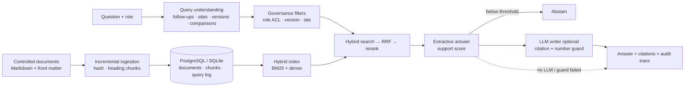

# Enterprise RAG Platform

[](https://github.com/raj75114043-design/enterprise-rag-platform/actions/workflows/ci.yml)
[](https://raj-enterprise-rag-platform.streamlit.app)


Governed retrieval-augmented question answering over **GxP controlled documents** (SOPs, policies, site annexes and
restricted investigation records) for a fictional pharmaceutical manufacturer, Meridian Pharma.

> **Live console:** https://raj-enterprise-rag-platform.streamlit.app — switch roles in the sidebar to see access control. All documents are synthetic.

---

## The problem

Quality teams answer the same questions every day — *"How long do we have for a Phase I OOS investigation?"*,
*"Is the dirty hold time different at Sikkim?"* — by searching document management systems. A generic chatbot over
those documents fails in ways that matter in a regulated environment:

| Failure | Why it matters | How this platform handles it |
|---|---|---|
| Quotes a **superseded** SOP version | Inspection finding; wrong practice | Version-aware filtering; history only when asked ("in version 3.0", "in 2024") |
| Ignores **site annexes** | Site-specific rules are silently wrong | Site detection; annexes override the global SOP for that site only |
| Leaks **restricted** documents | Investigation records and inspection plans are confidential | Role-based access filter applied *before* retrieval; restricted documents are not even listed |
| **Hallucinates** a timeline | A wrong number becomes a deviation | Extractive answer by default; LLM output must pass citation and number checks |
| Answers when it should not | False confidence | IDF-weighted support score; abstains below threshold |

## Capabilities

- **Structure-aware ingestion** — Markdown controlled documents with front matter (ID, version, status, effective date, access, site); heading-based chunks with breadcrumb headers; SHA-256 incremental re-indexing (added / updated / unchanged / removed).
- **Hybrid retrieval** — BM25 + dense vectors (offline LSA by default, `BAAI/bge-small-en-v1.5` via fastembed optional), Reciprocal Rank Fusion, feature-based reranking and per-document diversity.
- **Query understanding** — pharma acronym expansion (OOS, CAPA, APQR, HPLC, LIMS…), multi-turn follow-ups (*"And at Baddi?"*), version and as-of-date filters, and comparison decomposition (*"Compare … between Goa and Sikkim"* → one sub-query per site).
- **Grounded answers** — every statement cites a chunk ID such as `[SOP-QA-001@4.0#5.1]`; superseded and site-annex sources are labelled in the answer.
- **Optional LLM writer** — Groq free tier (open-weight `openai/gpt-oss-120b`) or local Ollama. Accepted only if all citations refer to retrieved chunks and every number appears in the cited text; one corrective retry, then extractive fallback.
- **Operations** — FastAPI with role-mapped API keys, request IDs, JSON logs, Prometheus metrics, persisted audit trace per answer, user feedback, Docker and PostgreSQL.

## Architecture



### Example

```
Q (qa_analyst): Compare the dirty equipment hold time between Goa and Sikkim.

- Goa: The maximum dirty equipment hold time is 48 hours after the end of manufacturing. [SOP-PRD-020@3.0#5.2]
- Sikkim: At Sikkim, the maximum dirty equipment hold time is 24 hours after the end of manufacturing. [SOP-PRD-020-SKM@1.0#5.1]
  SOP-PRD-020-SKM is a site annex that modifies SOP-PRD-020 for Sikkim.

[extractive · confidence HIGH · ~5 ms]
```

The same question about batch MP-2309 returns the investigation finding to `qa_head` and an abstention to `qa_analyst`,
without revealing that a restricted document exists.

## Evaluation

The document set and the golden questions are generated from one specification (`ragp/corpus/spec.py`), so expected
answers cannot drift from the documents. CI regenerates the corpus and fails if it differs from what is committed.

| Metric (75 questions, extractive mode) | Result | Gate |
|---|---|---|
| Retrieval recall@5 | 100% | ≥ 95% |
| MRR | 0.97 | — |
| Answer accuracy (expected value present) | 98.5% (64/65) | ≥ 90% |
| Abstention accuracy (unanswerable + access-denied) | 100% (10/10) | ≥ 90% |
| False abstention | 0% | ≤ 5% |
| Access-control leakage | 0 | = 0 |
| Stale (superseded) version answers | 0% | ≤ 2% |
| Citation validity | 100% | 100% |
| Latency p50 / p95 (no LLM) | ~4 ms / ~10 ms | — |

By scenario: current 48/49 · version history 4/4 · site annex 2/2 · site fallback 2/2 · comparison 2/2 · follow-up 2/2 ·
confidential (authorised) 4/4 · access denied 4/4 · unanswerable 6/6.

**Read these numbers honestly.** The corpus is small (21 document versions) and synthetic, and the retrieval rules
were tuned against it, so these numbers show the pipeline and its safeguards behave as designed. They are not
evidence of accuracy on a real document management system. The remaining failure — *"What do we do with material
after a temperature excursion?"* — selects the reporting sentence instead of the quarantine sentence; see
[docs/evaluation.md](docs/evaluation.md).

## Quick start

```bash
pip install -r requirements-dev.txt
make test eval          # 21 tests + quality gate
make console            # http://localhost:8501
make api                # http://localhost:8000/docs
```

```bash
cp .env.example .env    # optionally set GROQ_API_KEY
docker compose up --build              # PostgreSQL + ingestion + API + console
```

```bash
curl -s -X POST localhost:8000/v1/ask -H "X-API-Key: analyst-key" -H "Content-Type: application/json" \
     -d '{"question": "And at Baddi?", "previous": "What is the closure timeline for a minor deviation?"}' | jq .answer
```

| Role (API key) | Can read |
|---|---|
| `operator` (`operator-key`) | public |
| `qa_analyst` (`analyst-key`) | public, internal |
| `qa_head` (`head-key`) | public, internal, confidential · may trigger ingestion |

## Repository layout

```
ragp/
  corpus/spec.py       document families, facts, versions, site annexes (single source of truth)
  corpus/generator.py  renders controlled documents and the golden set
  ingest.py            front-matter validation, heading chunking, incremental ingestion
  index.py             BM25 + dense (LSA / bge-small) hybrid index with RRF
  query.py             follow-up resolution, site/version/date filters, comparison decomposition
  retriever.py         access/version/site filtering before search, reranking, diversity
  answer.py            extractive answer, abstention, LLM writer with citation and number guards
  pipeline.py          orchestration, audit trace, container
  api.py               FastAPI service · eval/run.py quality gate · cli.py
corpus/                21 generated controlled documents (Markdown)
eval/golden.jsonl      75 generated golden questions
streamlit_app.py       quality knowledge assistant console
docs/                  architecture, ADRs, runbook, evaluation notes
```

## Design decisions

- [ADR-0001](docs/adr/0001-filter-before-retrieval.md) — enforce access, version and site rules before search, not after
- [ADR-0002](docs/adr/0002-extractive-first-llm-optional.md) — extractive answers by default; the LLM is a writer, never the source of facts
- [ADR-0003](docs/adr/0003-generated-corpus-and-golden-set.md) — generate documents and golden questions from one specification

## Limitations and roadmap

- Markdown only; PDF and Word ingestion (with table extraction) would be the first connector to add.
- Sentence-level extraction cannot synthesise answers spread across sections; the LLM writer covers this when enabled.
- Roles are simulated with API keys; production would map SSO/Entra ID groups.
- Roadmap: pgvector storage for large corpora, cross-encoder reranking, document-change notifications, LLM-as-judge for answer quality.

## Licence

MIT
